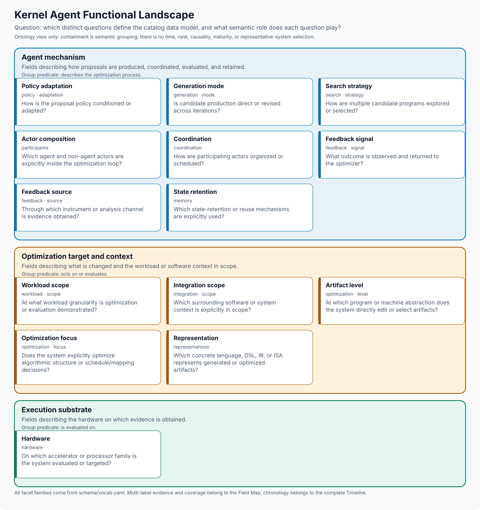
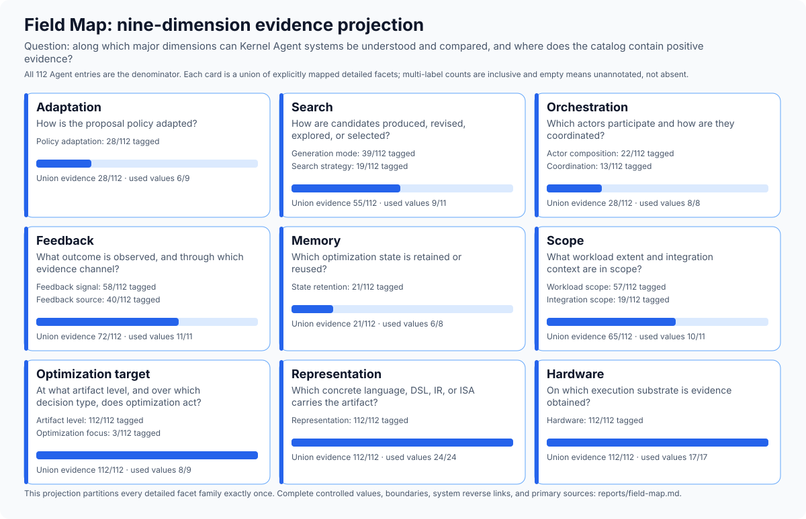
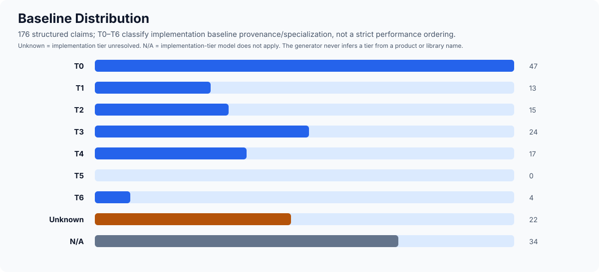
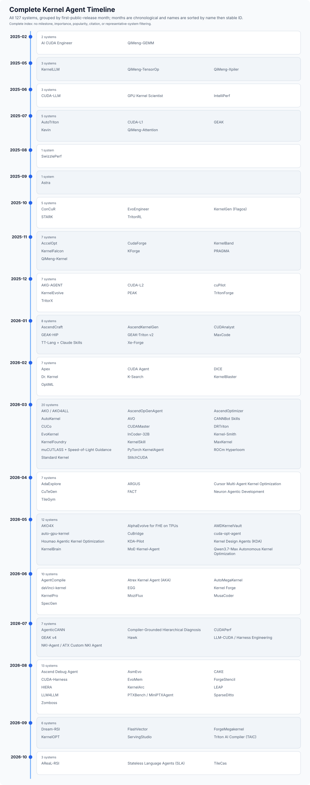

# Awesome Kernel Agent（中文版） [](https://awesome.re) [](CONTRIBUTING.md)

> 面向 LLM 加速器 Kernel 生成与优化研究的高密度、证据驱动索引。

[English](README.md) · [Benchmarks](BENCHMARKS.md) · [数据](data/agents.json) · [贡献指南](CONTRIBUTING.md)

**112 个 Agent 系统** · **145 条结构化 claims** · **45 条带 claim 对应 artifact** · **17 类硬件目标** · 另收录 **3 个工具条目** · 检索截止 **2026-08-25**

## Research Landscape

**Research Landscape 回答的问题：** 这份 catalog 用哪些彼此有明确边界的问题描述 Kernel Agent，每个问题扮演什么语义角色？

[](assets/landscape.svg)
_Landscape 是由[明确 facet 定义](reports/landscape.md)生成的纯包含关系 ontology，不表达时间、因果、成熟度或系统选择。_

## 最新工作

[Ascend Debug Agent](catalog/2026.md#ascend-debug-agent) · [AsmEvo](catalog/2026.md#asmevo) · [CAKE](catalog/2026.md#cake) · [EvoMem](catalog/2026.md#evomem) · [ForgeStencil](catalog/2026.md#forgestencil)

## 如何阅读 Catalog

- **画像：** 它是对已有 taxonomy 证据的确定性、仅用于展示的摘要。第二行列出具体 Representation；完整 facets 保留在年度 catalog 中。`—` 表示未标注，不表示不存在。
- **Baseline Tier：** T0 参考实现/框架 · T1 通用编译器生成 · T2 优化通用/厂商库 · T3 专用专家实现 · T4 生产 incumbent · T5 外部核验的 best-known 实现 · T6 硬件上限。Tier 表示来源、专业化与部署状态，不保证运行时强弱顺序。**10× @ T0 可能不如 1.1× @ T4 有意义。** `Unknown` 表示实现 baseline 的层级尚未解决；`N/A` 表示该层级模型不适用。
- **证据：** `K` 表示当前展示 claim 的精确 winning artifact 是否可访问；`B` 表示其优化/搜索预算是否披露。✓ 是 · ◐ 部分 · — 否/不适用 · ? 未知。

## Agent Catalog

每行由 v2 taxonomy 和一个显式指定的 primary claim 自动生成。完整 taxonomy、全部 claims、denominator、artifact、预算、caveat 和来源保留在所链接的年度 catalog 中。

### 2026-08

| 系统 | 画像 | 主 claim | 证据 |
| --- | --- | --- | :---: |
| **[Ascend Debug Agent](catalog/2026.md#ascend-debug-agent)**<br><sub>City University of Hong Kong x Huawei · 未公开 · [Paper](https://arxiv.org/abs/2608.02712)</sub> | 迭代精化 · 编译器反馈<br><sub>Ascend C</sub> | 66.7% pass@1 · Ascend NPU<br><sub>N/A · fresh CANNBot-style regeneration</sub> | K — · B ✓ |
| **[AsmEvo](catalog/2026.md#asmevo)**<br><sub>AMD x Southern University of Science and Technology · 未公开 · [Paper](https://arxiv.org/abs/2608.20711)</sub> | 迭代精化 · Profiler<br><sub>AMDGPU ISA</sub> | 1.35× · AMD MI308X<br><sub>Unknown · original recovered AMDGPU code object</sub> | K — · B ✓ |
| **[CAKE](catalog/2026.md#cake)**<br><sub>NVIDIA x Carnegie Mellon University · 部分公开 · [Paper](https://arxiv.org/abs/2608.12629) · [Artifact: Upstream artifact tracker](https://github.com/flashinfer-ai/flashinfer/issues/4254)</sub> | Agent / 编译器协同 · IR 反馈<br><sub>CAKE IR · CUDA · PTX</sub> | 1.144× · NVIDIA B200<br><sub>T3 · tuned FlashML</sub> | K ◐ · B ◐ |
| **[EvoMem](catalog/2026.md#evomem)**<br><sub>Anonymous organization (Moscow) x Applied AI Institute x Lomonosov Moscow State University · 未公开 · [Paper](https://arxiv.org/abs/2608.10795)</sub> | 进化搜索 · 运行时反馈<br><sub>Triton</sub> | — | — |
| **[ForgeStencil](catalog/2026.md#forgestencil)**<br><sub>OpenBMB · 开源 · [Code](https://github.com/OpenBMB/ForgeStencil)</sub> | 多智能体 · Profiler<br><sub>CUDA</sub> | 1.41× · NVIDIA A100<br><sub>T4 · each application's production GPU path</sub> | K ✓ · B — |
| **[HIERA](catalog/2026.md#hiera)**<br><sub>Shanghai Jiao Tong University · 未公开 · [Paper](https://arxiv.org/abs/2608.21157)</sub> | 迭代精化 · Profiler<br><sub>CUDA</sub> | 92.4% 通过率 · NVIDIA A100<br><sub>N/A · PyTorch reference</sub> | K — · B ✓ |
| **[KernelArc](catalog/2026.md#kernelarc)**<br><sub>AI Labs x imec · 未公开 · [Paper](https://arxiv.org/abs/2608.17071)</sub> | 组合搜索 · 运行时反馈<br><sub>CUDA · PTX · Triton · +1</sub> | — | — |
| **[LEAP](catalog/2026.md#leap-kernel-rl)**<br><sub>Moore Threads AI · 未公开 · [Paper](https://arxiv.org/abs/2608.01804)</sub> | 强化学习 · 编译器反馈<br><sub>CUDA</sub> | 80.8% 通过率 · NVIDIA GPU<br><sub>N/A · first-turn pass rate of 70.0%</sub> | K — · B ✓ |
| **[LLM4LLM](catalog/2026.md#llm4llm)**<br><sub>Xidian University x Zhongguancun Academy · 部分公开 · [Paper](https://arxiv.org/abs/2608.21836) · [Code](https://github.com/hzeng2000/LLM4LLM)</sub> | 迭代精化 · Profiler<br><sub>Triton · CUDA · TileLang</sub> | 3.91× · NVIDIA A100<br><sub>T0 · PyTorch eager</sub> | K — · B ✓ |
| **[PTXBench / MiniPTXAgent](catalog/2026.md#ptxbench-miniptxagent)**<br><sub>Stanford x Carnegie Mellon University x RadixArk · 开源 · [Paper](https://arxiv.org/abs/2608.17379) · [Code](https://github.com/zhang677/PTXBench)</sub> | IR 反馈<br><sub>CUDA · PTX · Triton</sub> | — | — |
| **[SparseDitto](catalog/2026.md#sparse-ditto)**<br><sub>University of Minnesota x Northeastern University · 未公开 · [Paper](https://arxiv.org/abs/2608.05033)</sub> | 正确性反馈<br><sub>CUDA</sub> | 2.68× · NVIDIA RTX PRO 6000<br><sub>T2 · fastest applicable cuSPARSE path</sub> | K — · B ✓ |
| **[Zomboss](catalog/2026.md#zomboss)**<br><sub>University of Michigan x University of Texas at Austin · 未公开 · [Paper](https://arxiv.org/abs/2608.00894)</sub> | Best-of-N · 编译器反馈<br><sub>ACT · TAIDL</sub> | 3.34× · Gemmini FPGA<br><sub>T1 · compiler-default mapping</sub> | K — · B ✓ |

### 2026-07

| 系统 | 画像 | 主 claim | 证据 |
| --- | --- | --- | :---: |
| **[AgenticCANN](catalog/2026.md#agenticcann)**<br><sub>City University of Hong Kong x Hong Kong Yuwin Technology · 未公开 · [Paper](https://arxiv.org/abs/2607.26661)</sub> | 进化搜索 · 运行时反馈<br><sub>Ascend C</sub> | 6.65× · Ascend NPU<br><sub>T0 · PyTorch reference</sub> | K — · B ✓ |
| **[Compiler-Grounded Hierarchical Diagnosis](catalog/2026.md#compiler-grounded-hierarchical-diagnosis)**<br><sub>Huawei Technologies · 开源 · [Paper](https://arxiv.org/abs/2607.23089) · [Code](https://gitcode.com/cann/cannbot-skills)</sub> | 迭代精化 · 编译器反馈<br><sub>Triton</sub> | 4.35× · Ascend 950<br><sub>Unknown · validated initial Triton kernel</sub> | K — · B ✓ |
| **[CUDAPerf](catalog/2026.md#cudaperf)**<br><sub>Iowa State University x Cisco AI Research · 未公开 · [Paper](https://arxiv.org/abs/2607.20908)</sub> | 强化学习 · 正确性反馈<br><sub>CUDA</sub> | 6.41× · NVIDIA GPU<br><sub>T0 · PyTorch reference</sub> | K — · B ✓ |
| **[GEAK v4](catalog/2026.md#geak-v4)**<br><sub>AMD-AGI · 开源 · [Code](https://github.com/AMD-AGI/GEAK) · [Article](https://www.amd.com/en/developer/resources/technical-articles/2026/geak-v4.html)</sub> | 多智能体 · 运行时反馈<br><sub>HIP · Triton · FlyDSL · +2</sub> | 2.21× · AMD GPU<br><sub>Unknown · original per-task kernel</sub> | K ◐ · B ✓ |
| **[Hawk](catalog/2026.md#hawk-npu)**<br><sub>Sun Yat-sen University x GBA National Technology Innovation Center x Peng Cheng Laboratory · 未公开 · [Paper](https://arxiv.org/abs/2607.01590)</sub> | 蒸馏 · 正确性反馈<br><sub>Ascend C</sub> | 1.34× · Ascend NPU<br><sub>T0 · PyTorch reference</sub> | K — · B ✓ |
| **[LLM-CUDA / Harness Engineering](catalog/2026.md#llm-cuda-harness-engineering)**<br><sub>Baidu · 开源 · [Paper](https://arxiv.org/abs/2607.17979) · [Code](https://github.com/syhya/mlsys26-flashinfer-contest)</sub> | 迭代精化 · 正确性反馈<br><sub>CUDA · Triton · CUTLASS</sub> | 1.62× · NVIDIA B200<br><sub>T3 · supplied FlashInfer contest baseline</sub> | K ◐ · B ✓ |
| **[NKI-Agent / ATX Custom NKI Agent](catalog/2026.md#atx-custom-nki-agent)**<br><sub>Amazon Web Services · 开源 · [Paper](https://arxiv.org/abs/2607.04395) · [Code](https://github.com/aws-samples/sample-ATX-custom-NKI-Agent)</sub> | SFT · 编译器反馈<br><sub>NKI</sub> | 77.3% 通过率 · AWS Trainium<br><sub>N/A · single-shot Claude without agent tools (6% pass rate)</sub> | K ◐ · B ✓ |

### 2026-06

| 系统 | 画像 | 主 claim | 证据 |
| --- | --- | --- | :---: |
| **[AgentCompile](catalog/2026.md#agentcompile)**<br><sub>City University of Hong Kong (Dongguan) x City University of Hong Kong · 部分公开 · [Paper](https://arxiv.org/abs/2606.07665) · [Code](https://github.com/veneno1213822/AgentCompile)</sub> | 迭代精化 · 编译器反馈<br><sub>CUDA</sub> | 2.23–6.98× · NVIDIA GPU<br><sub>T0 · PyTorch eager</sub> | K — · B ◐ |
| **[Atrex Kernel Agent (AKA)](catalog/2026.md#atrex-kernel-agent)**<br><sub>ATREX Team, Alibaba Group · 开源 · [Paper](https://arxiv.org/abs/2607.14541) · [Code](https://github.com/alibaba/atrex-kernel-agent)</sub> | Profiler<br><sub>FlyDSL · Triton · CUDA · +2</sub> | 最高 1.31× · anonymized XPU-A<br><sub>T4 · deployed production kernel (AITER where applicable)</sub> | K — · B ◐ |
| **[AutoMegaKernel](catalog/2026.md#automegakernel)**<br><sub>RightNow AI (YC) · 开源 · [Paper](https://arxiv.org/abs/2606.09682) · [Code](https://github.com/RightNow-AI/AutoMegaKernel)</sub> | 迭代精化 · 编译器反馈<br><sub>CUDA</sub> | 1.25–1.72× · NVIDIA GPU<br><sub>Unknown · pre-autoresearch AutoMegaKernel</sub> | K ◐ · B ◐ |
| **[daVinci-kernel](catalog/2026.md#davinci-kernel)**<br><sub>Shanghai Innovation Institute x Shanghai Jiao Tong University x GAIR · 开源 · [Paper](https://arxiv.org/abs/2606.16497) · [Code](https://github.com/GAIR-NLP/daVinci-kernel)</sub> | SFT · 技能库<br><sub>CUDA · Triton</sub> | 37.2% 通过率 · NVIDIA GPU<br><sub>T0 · PyTorch reference Fast_1 threshold</sub> | K — · B ✓ |
| **[EGG](catalog/2026.md#egg-kernel)**<br><sub>Beihang University x Shanghai Jiao Tong University x Tsinghua University x Approaching.AI · 未公开 · [Paper](https://arxiv.org/abs/2606.26758)</sub> | 多智能体 · Profiler<br><sub>Triton</sub> | 2.13× · NVIDIA RTX 4090<br><sub>T0 · PyTorch eager</sub> | K — · B ✓ |
| **[Kernel Forge](catalog/2026.md#kernel-forge)**<br><sub>University of Michigan · 开源 · [Paper](https://arxiv.org/abs/2607.24762) · [Code](https://github.com/TheJoshBrod/KernelForge)</sub> | MCTS · 正确性反馈<br><sub>CUDA · Triton</sub> | 最高 2.83× · NVIDIA GB10<br><sub>T0 · PyTorch eager</sub> | K ✓ · B ✓ |
| **[KernelPro](catalog/2026.md#kernelpro)**<br><sub>Amazon Web Services x Siemens x University of Minnesota · 未公开 · [Paper](https://arxiv.org/abs/2606.26453) · [Artifact: Appendix H kernel artifact](https://arxiv.org/abs/2606.26453)</sub> | MCTS · Profiler<br><sub>CUDA · CUTLASS · CuTe</sub> | 2.42× · NVIDIA GPU<br><sub>T0 · PyTorch eager</sub> | K ◐ · B ✓ |
| **[MoziFlux](catalog/2026.md#moziflux)**<br><sub>BiSheng-Compiler-Agents · 开源 · [Code](https://github.com/BiSheng-Compiler-Agents/MoziFlux)</sub> | 迭代精化 · 模拟器<br><sub>Triton</sub> | — | — |
| **[MusaCoder](catalog/2026.md#musacoder)**<br><sub>Moore Threads · 部分公开 · [Paper](https://arxiv.org/abs/2606.04847) · [Model](https://huggingface.co/MooreThreads/MusaCoder-27B)</sub> | 强化学习<br><sub>MUSA C · CUDA</sub> | — | — |
| **[SpecGen](catalog/2026.md#specgen)**<br><sub>Fudan University x Shanghai Jiao Tong University x Shanghai AI Laboratory x HKUST x CUHK x SenseTime Research · 未公开 · [Paper](https://arxiv.org/abs/2606.17518)</sub> | Parallel · Profiler<br><sub>CUDA · Triton</sub> | — | — |

### 2026-05

| 系统 | 画像 | 主 claim | 证据 |
| --- | --- | --- | :---: |
| **[AKO4X](catalog/2026.md#ako4x)**<br><sub>TLAIC · 开源 · [Code](https://github.com/TongmingLAIC/AKO4X)</sub> | 迭代精化 · 正确性反馈<br><sub>Triton · CUDA · TileLang · +2</sub> | 最高 30.71× · NVIDIA B200<br><sub>T3 · FlashInfer expert kernel</sub> | K ✓ · B ? |
| **[AlphaEvolve for FHE on TPUs](catalog/2026.md#alphaevolve-fhe)**<br><sub>Google · 未公开 · [Paper](https://arxiv.org/abs/2605.14718)</sub> | 进化搜索<br><sub>JAX</sub> | 2.5× · TPU v5e<br><sub>T3 · human state-of-the-art implementation</sub> | K — · B ✓ |
| **[auto-gpu-kernel](catalog/2026.md#auto-gpu-kernel)**<br><sub>Dogacel · 开源 · [Code](https://github.com/Dogacel/auto-gpu-kernel)</sub> | 迭代精化 · 正确性反馈<br><sub>Triton</sub> | 34.93× · NVIDIA B200<br><sub>T3 · contest reference kernel</sub> | K ✓ · B ◐ |
| **[CuBridge](catalog/2026.md#cubridge)**<br><sub>Shanghai Jiao Tong University · 未公开 · [Paper](https://arxiv.org/abs/2605.05023)</sub> | 迭代精化 · 编译器反馈<br><sub>CUDA</sub> | — | — |
| **[cuda-opt-agent](catalog/2026.md#cuda-opt-agent)**<br><sub>KernelFlow-ops · 开源 · [Code](https://github.com/KernelFlow-ops/cuda-opt-agent)</sub> | 迭代精化 · 编译器反馈<br><sub>CUDA</sub> | — | — |
| **[Houmao Agentic Kernel Optimization](catalog/2026.md#houmao-agentic-kernel-optimization)**<br><sub>Intellifusion · 部分公开 · [Paper](https://arxiv.org/abs/2608.14560) · [Code](https://github.com/igamenovoer/houmao) · [Artifact: Accepted CUDA kernels](https://github.com/CodeGandee/flashinfer-bench-starter-kit/tree/main/solution/cuda)</sub> | 多智能体 · 正确性反馈<br><sub>CUDA · CUTLASS</sub> | 1.71× · NVIDIA B200<br><sub>T3 · supplied FlashInfer contest baseline</sub> | K ✓ · B ✓ |
| **[KDA-Pilot](catalog/2026.md#kernelpilot)**<br><sub>BBuf · 开源 · [Code](https://github.com/BBuf/KDA-Pilot)</sub> | Profiler<br><sub>Triton · CUDA · CUTLASS</sub> | 2.7499× · NVIDIA B200<br><sub>T4 · copied SGLang production baseline</sub> | K ✓ · B ◐ |
| **[Kernel Design Agents (KDA)](catalog/2026.md#kernel-design-agents)**<br><sub>MIT HAN Lab · 开发中 · [Code](https://github.com/mit-han-lab/kernel-design-agents)</sub> | 迭代精化 · 正确性反馈<br><sub>CUDA</sub> | — | — |
| **[KernelBrain](catalog/2026.md#kernelbrain)**<br><sub>Microsoft · 未公开 · [Paper](https://arxiv.org/abs/2608.02611)</sub> | 迭代精化 · Profiler<br><sub>Triton</sub> | — | — |
| **[MoE-Kernel-Agent](catalog/2026.md#moe-kernel-agent)**<br><sub>Jerry2423 · 开源 · [Code](https://github.com/Jerry2423/MoE-Kernel-Agent)</sub> | 迭代精化 · 正确性反馈<br><sub>Triton</sub> | 25.7× · NVIDIA B200<br><sub>T0 · PyTorch reference implementation</sub> | K ✓ · B ◐ |
| **[Qwen3.7-Max Autonomous Kernel Optimization](catalog/2026.md#qwen3.7-max-kernel-opt)**<br><sub>Alibaba / Qwen Team · 专有 · [Article](https://qwen.ai/blog?id=qwen3.7)</sub> | 运行时反馈<br><sub>Triton</sub> | 10× · T-Head Zhenwu M890 PPU<br><sub>T4 · SGLang official Triton reference implementation</sub> | K — · B ✓ |

### 2026-04

| 系统 | 画像 | 主 claim | 证据 |
| --- | --- | --- | :---: |
| **[AdaExplore](catalog/2026.md#adaexplore)**<br><sub>CMU · 开源 · [Paper](https://arxiv.org/abs/2604.16625) · [Code](https://github.com/StigLidu/AdaExplore)</sub> | —<br><sub>CUDA</sub> | — | — |
| **[ARGUS](catalog/2026.md#argus)**<br><sub>Mai, Kozyrakis, Yuan et al. · 开发中 · [Paper](https://arxiv.org/abs/2604.18616)</sub> | 上下文学习 · 编译器反馈<br><sub>HIP</sub> | — | — |
| **[Cursor Multi-Agent Kernel Optimization](catalog/2026.md#cursor-nvidia-multi-agent-kernels)**<br><sub>Cursor / NVIDIA · 开源 · [Article](https://cursor.com/blog/multi-agent-kernels) · [Artifact: Generated kernel results](https://github.com/anysphere/kernel-optimization-results)</sub> | Planner Worker · 正确性反馈<br><sub>CUDA · CUTLASS · CuTe · +1</sub> | +38% 加速 · NVIDIA B200<br><sub>Unknown · PyTorch code already optimized by a single agent</sub> | K ✓ · B ◐ |
| **[CuTeGen](catalog/2026.md#cutegen)**<br><sub>U Toronto x Standard Kernel · 开源 · [Paper](https://arxiv.org/abs/2604.01489) · [Code](https://github.com/taratt/cutegen)</sub> | 迭代精化 · Profiler<br><sub>CuTe</sub> | 1.71× · NVIDIA GPU<br><sub>T0 · PyTorch</sub> | K ? · B ? |
| **[FACT](catalog/2026.md#fact)**<br><sub>Heidari &amp; Nikolopoulos · 未公开 · [Paper](https://arxiv.org/abs/2604.26666)</sub> | 自动调优<br><sub>CUTLASS</sub> | 2.03× · NVIDIA GPU<br><sub>T0 · PyTorch eager</sub> | K — · B ? |
| **[Neuron Agentic Development](catalog/2026.md#neuron-agentic-development)**<br><sub>AWS · 开源 · [Code](https://github.com/aws-neuron/neuron-agentic-development) · [Article](https://aws.amazon.com/blogs/machine-learning/stop-hand-tuning-kernels-how-neuron-agentic-development-accelerates-aws-trainium-optimizations/)</sub> | Profiler<br><sub>NKI</sub> | — | — |
| **[TileGym](catalog/2026.md#tilegym)**<br><sub>NVIDIA · 开源 · [Code](https://github.com/NVIDIA/TileGym) · [Article](https://developer.nvidia.com/blog/automating-gpu-kernel-translation-with-ai-agents-cutile-python-to-cutile-jl/)</sub> | 直接生成 · 技能库<br><sub>cuTile</sub> | — | — |

### 2026-03

| 系统 | 画像 | 主 claim | 证据 |
| --- | --- | --- | :---: |
| **[AKO / AKO4ALL](catalog/2026.md#ako)**<br><sub>TLAIC · 开源 · [Code](https://github.com/TongmingLAIC/AKO4ALL) · [Project](https://tongminglaic.github.io/AKO/)</sub> | —<br><sub>Triton · CUDA · TileLang</sub> | 10 次胜出 · NVIDIA GPU<br><sub>N/A · SOL-ExecBench agent-optimized NVIDIA baseline</sub> | K ? · B ? |
| **[AscendOptimizer](catalog/2026.md#ascendoptimizer)**<br><sub>ECNU x Tongji · 部分公开 · [Paper](https://arxiv.org/abs/2603.23566)</sub> | 情景记忆<br><sub>Ascend C</sub> | 1.21× · Ascend NPU<br><sub>T3 · Ascend reference operator</sub> | K ? · B ? |
| **[AutoKernel](catalog/2026.md#autokernel)**<br><sub>RightNow AI (YC) · 开源 · [Paper](https://arxiv.org/abs/2603.21331) · [Code](https://github.com/RightNow-AI/autokernel)</sub> | 迭代精化 · 编译器反馈<br><sub>CUDA · Triton</sub> | 5.29× · NVIDIA H100<br><sub>T0 · PyTorch eager</sub> | K ? · B ✓ |
| **[AVO](catalog/2026.md#avo)**<br><sub>NVIDIA x OctoML (23 authors) · 部分公开 · [Paper](https://arxiv.org/abs/2603.24517) · [Project: Community reimplementation (community)](https://github.com/austin1997/AVO)</sub> | 进化搜索 · 正确性反馈<br><sub>CUDA · PTX</sub> | +10.5% 加速 · NVIDIA B200<br><sub>T3 · FlashAttention-4</sub> | K — · B ✓ |
| **[CANNBot Skills](catalog/2026.md#cannbot-skills)**<br><sub>Huawei CANN · 开源 · [Code](https://gitcode.com/cann/cannbot-skills)</sub> | Profiler<br><sub>Ascend C · Catlass · PyPTO · +2</sub> | — | — |
| **[CUCo](catalog/2026.md#cuco)**<br><sub>UT Austin · 开源 · [Paper](https://arxiv.org/abs/2603.02376) · [Code](https://github.com/UT-InfraAI/cuco)</sub> | 进化搜索 · 正确性反馈<br><sub>CUDA</sub> | 最高 1.57× · NVIDIA GPU<br><sub>T0 · host-driven CPU-launched collectives/streams</sub> | K ◐ · B ✓ |
| **[CUDAMaster](catalog/2026.md#cudamaster)**<br><sub>Tsinghua · 部分公开 · [Paper](https://arxiv.org/abs/2603.07169) · [Project](https://hanyx2021.github.io/MSKernelBenchDemo/)</sub> | 多智能体 · Profiler<br><sub>CUDA</sub> | — | — |
| **[DRTriton](catalog/2026.md#drtriton)**<br><sub>Texas A&amp;M · 开发中 · [Paper](https://arxiv.org/abs/2603.21465)</sub> | 强化学习 · 正确性反馈<br><sub>Triton</sub> | 92% 胜率 · NVIDIA GPU (model not specified in v1)<br><sub>T0 · PyTorch eager</sub> | K ? · B ◐ |
| **[EvoKernel](catalog/2026.md#evokernel)**<br><sub>SJTU · 部分公开 · [Paper](https://arxiv.org/abs/2603.10846) · [Project](https://evokernel.zhuo.li/)</sub> | SFT · 正确性反馈<br><sub>Ascend C</sub> | — | — |
| **[InCoder-32B](catalog/2026.md#incoder-32b)**<br><sub>Beihang University · 开源 · [Paper](https://arxiv.org/abs/2604.03144) · [Code](https://github.com/CSJianYang/Industrial-Coder)</sub> | 直接生成 · 正确性反馈<br><sub>CUDA</sub> | — | — |
| **[Kernel-Smith](catalog/2026.md#kernel-smith)**<br><sub>Shanghai AI Lab · 未公开 · [Paper](https://arxiv.org/abs/2603.28342)</sub> | 进化搜索<br><sub>Triton</sub> | — | — |
| **[KernelFoundry](catalog/2026.md#kernelfoundry)**<br><sub>Intel · 开发中 · [Paper](https://arxiv.org/abs/2603.12440)</sub> | MAP-Elites<br><sub>SYCL · CUDA</sub> | — | — |
| **[KernelSkill](catalog/2026.md#kernelskill)**<br><sub>Beihang University · 开源 · [Paper](https://arxiv.org/abs/2603.10085) · [Code](https://github.com/0satan0/KernelMem)</sub> | 技能库<br><sub>CUDA</sub> | 5.44× · NVIDIA GPU<br><sub>T0 · PyTorch eager</sub> | K ? · B ? |
| **[muCUTLASS + Speed-of-Light Guidance](catalog/2026.md#mucutlass-sol)**<br><sub>NVIDIA x Stanford · 开发中 · [Paper](https://arxiv.org/abs/2603.29010)</sub> | 上下文学习 · Roofline<br><sub>CUTLASS</sub> | — | — |
| **[PyTorch KernelAgent](catalog/2026.md#pytorch-kernelagent)**<br><sub>Meta / PyTorch · 开源 · [Code](https://github.com/meta-pytorch/KernelAgent) · [Article](https://pytorch.org/blog/kernelagent-hardware-guided-gpu-kernel-optimization-via-multi-agent-orchestration/)</sub> | Role Specialized · 编译器反馈<br><sub>Triton</sub> | 89% 硬件上限 · NVIDIA H100<br><sub>T6 · roofline</sub> | K ◐ · B ✓ |
| **[Standard Kernel](catalog/2026.md#standard-kernel)**<br><sub>Standard Kernel (startup) · 未公开 · [Article](https://standardkernel.com/blog/announcing-our-seed-round-is-kernel-generation-solved/)</sub> | —<br><sub>PTX</sub> | — | — |
| **[StitchCUDA](catalog/2026.md#stitchcuda)**<br><sub>University of Minnesota Twin Cities · 未公开 · [Paper](https://arxiv.org/abs/2603.02637)</sub> | Agentic RL · 正确性反馈<br><sub>CUDA</sub> | 1.72× · NVIDIA GPU<br><sub>Unknown · CudaForge</sub> | K ? · B ✓ |

### 2026-02

| 系统 | 画像 | 主 claim | 证据 |
| --- | --- | --- | :---: |
| **[Apex](catalog/2026.md#amd-apex)**<br><sub>AMD · 开源 · [Code](https://github.com/AMD-AGI/Apex)</sub> | 迭代精化 · 编译器反馈<br><sub>HIP · Triton</sub> | 最高 36.35× · AMD MI300X/MI355X<br><sub>Unknown · prior kernel in the same optimization run</sub> | K — · B ✓ |
| **[CUDA Agent](catalog/2026.md#cuda-agent)**<br><sub>ByteDance x Tsinghua · 部分公开 · [Paper](https://arxiv.org/abs/2602.24286) · [Code: Agent environment](https://github.com/BytedTsinghua-SIA/CUDA-Agent) · [Project](https://cuda-agent.github.io/) · [Project: Hugging Face paper page (third-party)](https://huggingface.co/papers/2602.24286) · [Dataset: CUDA-Agent-Ops-6K](https://huggingface.co/datasets/BytedTsinghua-SIA/CUDA-Agent-Ops-6K)</sub> | Agentic RL · 编译器反馈<br><sub>CUDA</sub> | 2.11× · NVIDIA GPU<br><sub>T1 · torch.compile</sub> | K ? · B ✓ |
| **[DICE](catalog/2026.md#dice)**<br><sub>Westlake University · 开源 · [Paper](https://arxiv.org/abs/2602.11715) · [Code](https://github.com/deadlykitten4/DICE)</sub> | 强化学习 · 正确性反馈<br><sub>CUDA</sub> | 47% 正确率 · NVIDIA GPU<br><sub>N/A · no comparative denominator</sub> | K — · B ◐ |
| **[Dr. Kernel](catalog/2026.md#dr-kernel)**<br><sub>HKUST-NLP · 开源 · [Paper](https://arxiv.org/abs/2602.05885) · [Code](https://github.com/hkust-nlp/KernelGYM)</sub> | 强化学习<br><sub>Triton</sub> | — | — |
| **[K-Search](catalog/2026.md#k-search)**<br><sub>UC Berkeley · 开源 · [Paper](https://arxiv.org/abs/2602.19128) · [Code](https://github.com/caoshiyi/K-Search)</sub> | 进化搜索<br><sub>CUDA</sub> | — | — |
| **[KernelBlaster](catalog/2026.md#kernelblaster)**<br><sub>NVIDIA x UC Berkeley · 未公开 · [Paper](https://arxiv.org/abs/2602.14293)</sub> | 上下文学习<br><sub>CUDA</sub> | — | — |
| **[OptiML](catalog/2026.md#optiml)**<br><sub>Iowa State University · 未公开 · [Paper](https://arxiv.org/abs/2602.12305)</sub> | MCTS · Profiler<br><sub>CUDA</sub> | — | — |

### 2026-01

| 系统 | 画像 | 主 claim | 证据 |
| --- | --- | --- | :---: |
| **[AscendCraft](catalog/2026.md#ascendcraft)**<br><sub>NJU x Huawei · 未公开 · [Paper](https://arxiv.org/abs/2601.22760)</sub> | 直接生成 · 正确性反馈<br><sub>Ascend C</sub> | — | — |
| **[AscendKernelGen](catalog/2026.md#ascendkernelgen)**<br><sub>Pengcheng Lab · 部分公开 · [Paper](https://arxiv.org/abs/2601.07160) · [Dataset](https://huggingface.co/datasets/AscendKernelGen/Ascend-COT-v1)</sub> | 强化学习<br><sub>Ascend C</sub> | — | — |
| **[CUDAnalyst](catalog/2026.md#cudanalyst)**<br><sub>Yee Hin Chong et al. · 开源 · [Paper](https://openreview.net/forum?id=s70zO5Lvvj) · [Code](https://github.com/yuxuan-z19/cudanalyst)</sub> | 进化搜索 · Profiler<br><sub>CUDA</sub> | — | — |
| **[GEAK-HIP](catalog/2026.md#geak-hip)**<br><sub>AMD-AGI · 开源 · [Code](https://github.com/AMD-AGI/GEAK) · [Article](https://rocm.blogs.amd.com/software-tools-optimization/geak-hip-optimizations/README.html)</sub> | 迭代精化<br><sub>HIP</sub> | — | — |
| **[GEAK-Triton v2](catalog/2026.md#geak-triton-v2)**<br><sub>AMD-AGI · 开源 · [Code](https://github.com/AMD-AGI/GEAK) · [Article](https://rocm.blogs.amd.com/artificial-intelligence/geak-agents-family/README.html)</sub> | —<br><sub>Triton</sub> | — | — |
| **[TT-Lang + Claude Skills](catalog/2026.md#tt-lang-claude-skills)**<br><sub>Tenstorrent · 开源 · [Code](https://github.com/tenstorrent/tt-lang)</sub> | 直接生成 · 模拟器<br><sub>TT-Lang</sub> | — | — |
| **[Xe-Forge](catalog/2026.md#xe-forge)**<br><sub>Intel Labs · 开源 · [Code](https://github.com/IntelLabs/Xe-Forge)</sub> | —<br><sub>Triton</sub> | — | — |

### 2025-12

| 系统 | 画像 | 主 claim | 证据 |
| --- | --- | --- | :---: |
| **[AKG-AGENT](catalog/2025.md#akg-agent)**<br><sub>Huawei x Hunan U · 开源 · [Paper](https://arxiv.org/abs/2512.23424) · [Code](https://github.com/mindspore-ai/akg/tree/master/akg_agents)</sub> | Role Specialized · 正确性反馈<br><sub>Triton · TileLang · Ascend C · +1</sub> | 1.46× · Ascend NPU<br><sub>T0 · PyTorch eager</sub> | K ? · B ✓ |
| **[CUDA-L2](catalog/2025.md#cuda-l2)**<br><sub>DeepReinforce · 开源 · [Paper](https://arxiv.org/abs/2512.02551) · [Code](https://github.com/ornith-ai/CUDA-L2)</sub> | —<br><sub>CUDA</sub> | — | — |
| **[cuPilot](catalog/2025.md#cupilot)**<br><sub>Southeast U x Tsinghua x Tsing Micro · 部分公开 · [Paper](https://arxiv.org/abs/2512.16465) · [Artifact: Generated kernel outputs](https://github.com/champloo2878/cuPilot-Kernels)</sub> | 多智能体<br><sub>CUDA</sub> | — | — |
| **[KernelEvolve](catalog/2025.md#kernelevolve)**<br><sub>Meta · 专有 · [Paper](https://arxiv.org/abs/2512.23236) · [Article](https://engineering.fb.com/2026/04/02/developer-tools/kernelevolve-how-metas-ranking-engineer-agent-optimizes-ai-infrastructure/)</sub> | Agentic RL · 检索记忆<br><sub>CUDA · Triton · TileLang · +2</sub> | +60% 吞吐量 · NVIDIA GPU<br><sub>T4 · internal production kernel</sub> | K — · B ? |
| **[PEAK](catalog/2025.md#peak)**<br><sub>Stanford x MSR Redmond · 未公开 · [Paper](https://arxiv.org/abs/2512.19018)</sub> | —<br><sub>CUDA · HIP</sub> | — | — |
| **[TritonForge](catalog/2025.md#tritonforge)**<br><sub>RLsys-Foundation · 开源 · [Paper](https://arxiv.org/abs/2512.09196) · [Code](https://github.com/RLsys-Foundation/TritonForge)</sub> | SFT<br><sub>Triton</sub> | — | — |
| **[TritorX](catalog/2025.md#tritorx)**<br><sub>Meta · 未公开 · [Paper](https://arxiv.org/abs/2512.10977)</sub> | 正确性反馈<br><sub>Triton</sub> | 481 个ATen operators已覆盖 · MTIA<br><sub>N/A · no comparative performance baseline</sub> | K — · B ? |

### 2025-11

| 系统 | 画像 | 主 claim | 证据 |
| --- | --- | --- | :---: |
| **[AccelOpt](catalog/2025.md#accelopt)**<br><sub>Stanford x AWS · 开发中 · [Paper](https://arxiv.org/abs/2511.15915) · [Code](https://github.com/zhang677/AccelOpt)</sub> | 迭代精化 · 运行时反馈<br><sub>NKI</sub> | 61% 硬件上限 · AWS Trainium 1<br><sub>T6 · peak throughput</sub> | K ? · B ? |
| **[CudaForge](catalog/2025.md#cudaforge)**<br><sub>UMN OptimAI Lab · 开源 · [Paper](https://arxiv.org/abs/2511.01884) · [Code](https://github.com/OptimAI-Lab/CudaForge)</sub> | 迭代精化 · Profiler<br><sub>CUDA</sub> | — | — |
| **[KernelBand](catalog/2025.md#kernelband)**<br><sub>PKU · 未公开 · [Paper](https://arxiv.org/abs/2511.18868)</sub> | 分层编排<br><sub>Triton</sub> | — | — |
| **[KernelFalcon](catalog/2025.md#kernelfalcon)**<br><sub>Meta / PyTorch · 开源 · [Code](https://github.com/meta-pytorch/KernelAgent) · [Article](https://pytorch.org/blog/kernelfalcon-autonomous-gpu-kernel-generation-via-deep-agents/)</sub> | 正确性反馈<br><sub>Triton</sub> | 100% 正确率 · NVIDIA GPU<br><sub>N/A · no comparative performance baseline</sub> | K ? · B ? |
| **[KForge](catalog/2025.md#kforge)**<br><sub>Gimlet Labs · 未公开 · [Paper](https://arxiv.org/abs/2606.02963)</sub> | 提示工程 · 编译器反馈<br><sub>Triton · CUDA · CUTLASS · +3</sub> | +2.12% 吞吐量 · NVIDIA B200<br><sub>Unknown · TensorRT-LLM 1.3.0rc9</sub> | K — · B ◐ |
| **[PRAGMA](catalog/2025.md#pragma)**<br><sub>Beihang University · 未公开 · [Paper](https://arxiv.org/abs/2511.06345)</sub> | 多智能体 · Profiler<br><sub>Triton</sub> | — | — |
| **[QiMeng-Kernel](catalog/2025.md#qimeng-kernel)**<br><sub>CAS ICT · 部分公开 · [Paper](https://arxiv.org/abs/2511.20100) · [Code](https://github.com/QiMeng-IPRC/QiMeng-Kernel)</sub> | —<br><sub>CUDA</sub> | — | — |

### 2025-10

| 系统 | 画像 | 主 claim | 证据 |
| --- | --- | --- | :---: |
| **[ConCuR](catalog/2025.md#concur)**<br><sub>HKUST · 开源 · [Paper](https://arxiv.org/abs/2510.07356) · [Model](https://huggingface.co/lkongam/KernelCoder)</sub> | SFT<br><sub>Triton</sub> | — | — |
| **[EvoEngineer](catalog/2025.md#evoengineer)**<br><sub>City University of Hong Kong · 未公开 · [Paper](https://arxiv.org/abs/2510.03760)</sub> | 进化搜索 · 运行时反馈<br><sub>CUDA</sub> | 2.72× · NVIDIA GPU<br><sub>T0 · PyTorch eager</sub> | K — · B ? |
| **[KernelGen (Flagos)](catalog/2025.md#kernelgen-flagos)**<br><sub>Flagos · 开源 · [Code](https://github.com/flagos-ai/kernelgen) · [Project](https://kernelgen.flagos.io/)</sub> | —<br><sub>Triton</sub> | — | — |
| **[STARK](catalog/2025.md#stark)**<br><sub>Meta · 未公开 · [Paper](https://arxiv.org/abs/2510.16996)</sub> | —<br><sub>CUDA</sub> | — | — |
| **[TritonRL](catalog/2025.md#tritonrl)**<br><sub>CMU x Amazon · 未公开 · [Paper](https://arxiv.org/abs/2510.17891)</sub> | —<br><sub>Triton</sub> | — | — |

### 2025-09

| 系统 | 画像 | 主 claim | 证据 |
| --- | --- | --- | :---: |
| **[Astra](catalog/2025.md#astra)**<br><sub>Stanford · 开源 · [Paper](https://arxiv.org/abs/2509.07506) · [Code](https://github.com/Anjiang-Wei/Astra)</sub> | 多智能体 · 检索记忆<br><sub>CUDA</sub> | 1.32× · NVIDIA GPU<br><sub>T4 · SGLang incumbent kernels</sub> | K ? · B ✓ |

### 2025-08

| 系统 | 画像 | 主 claim | 证据 |
| --- | --- | --- | :---: |
| **[SwizzlePerf](catalog/2025.md#swizzleperf)**<br><sub>Harvard x AMD · 未公开 · [Paper](https://arxiv.org/abs/2508.20258)</sub> | —<br><sub>Triton</sub> | — | — |

### 2025-07

| 系统 | 画像 | 主 claim | 证据 |
| --- | --- | --- | :---: |
| **[AutoTriton](catalog/2025.md#autotriton)**<br><sub>THUNLP / AI9Stars · 开源 · [Paper](https://arxiv.org/abs/2507.05687) · [Code](https://github.com/AI9Stars/AutoTriton)</sub> | SFT<br><sub>Triton</sub> | — | — |
| **[CUDA-L1](catalog/2025.md#cuda-l1)**<br><sub>DeepReinforce · 开源 · [Paper](https://arxiv.org/abs/2507.14111) · [Code](https://github.com/ornith-ai/CUDA-L1)</sub> | 强化学习<br><sub>CUDA</sub> | 3.12× · NVIDIA A100<br><sub>T0 · PyTorch eager</sub> | K ◐ · B ? |
| **[GEAK](catalog/2025.md#geak)**<br><sub>AMD-AGI · 开源 · [Paper](https://arxiv.org/abs/2507.23194) · [Code](https://github.com/AMD-AGI/GEAK)</sub> | Parallel · 运行时反馈<br><sub>Triton</sub> | 2.59× · AMD MI300X<br><sub>T3 · expert reference kernels</sub> | K ? · B ✓ |
| **[Kevin](catalog/2025.md#kevin)**<br><sub>Cognition · 部分公开 · [Paper](https://arxiv.org/abs/2507.11948)</sub> | 强化学习 · 正确性反馈<br><sub>CUDA</sub> | 1.1× · NVIDIA GPU<br><sub>T0 · PyTorch eager</sub> | K ? · B ✓ |
| **[QiMeng-Attention](catalog/2025.md#qimeng-attention)**<br><sub>CAS ICT · 未公开 · [Paper](https://aclanthology.org/2025.findings-acl.446/)</sub> | —<br><sub>CUDA</sub> | 2.15× · NVIDIA A100<br><sub>T2 · cuDNN</sub> | K — · B ? |

### 2025-06

| 系统 | 画像 | 主 claim | 证据 |
| --- | --- | --- | :---: |
| **[CUDA-LLM](catalog/2025.md#cuda-llm)**<br><sub>Shanghai Jiao Tong University · 未公开 · [Paper](https://arxiv.org/abs/2506.09092)</sub> | 提示工程<br><sub>CUDA</sub> | — | — |
| **[GPU Kernel Scientist](catalog/2025.md#gpu-kernel-scientist)**<br><sub>Anonymous · 未公开 · [Paper](https://arxiv.org/abs/2506.20807)</sub> | 迭代精化<br><sub>CUDA</sub> | — | — |
| **[IntelliPerf](catalog/2025.md#intelliperf)**<br><sub>AMD Research · 开源 · [Code](https://github.com/AMDResearch/intelliperf)</sub> | Profiler<br><sub>HIP · Triton</sub> | — | — |

### 2025-05

| 系统 | 画像 | 主 claim | 证据 |
| --- | --- | --- | :---: |
| **[KernelLLM](catalog/2025.md#kernelllm)**<br><sub>Meta · 部分公开 · [Model](https://huggingface.co/facebook/KernelLLM)</sub> | SFT<br><sub>Triton</sub> | — | — |
| **[QiMeng-TensorOp](catalog/2025.md#qimeng-tensorop)**<br><sub>CAS ICT · 未公开 · [Paper](https://arxiv.org/abs/2505.06302)</sub> | MCTS<br><sub>CUDA</sub> | 124% 基线吞吐量 · NVIDIA GPU<br><sub>T2 · cuBLAS</sub> | K — · B ? |
| **[QiMeng-Xpiler](catalog/2025.md#qimeng-xpiler)**<br><sub>CAS ICT x USTC x Cambricon · 开发中 · [Paper](https://arxiv.org/abs/2505.02146)</sub> | 自动调优 · 编译器反馈<br><sub>CUDA · HIP</sub> | 95% 准确率 · multiple accelerators<br><sub>N/A · no comparative denominator</sub> | K ? · B ? |

### 2025-02

| 系统 | 画像 | 主 claim | 证据 |
| --- | --- | --- | :---: |
| **[AI CUDA Engineer](catalog/2025.md#ai-cuda-engineer)**<br><sub>Sakana AI · 部分公开 · [Paper](https://arxiv.org/abs/2509.14279) · [Dataset](https://huggingface.co/datasets/SakanaAI/AI-CUDA-Engineer-Archive)</sub> | 正确性反馈<br><sub>CUDA</sub> | — | — |
| **[QiMeng-GEMM](catalog/2025.md#qimeng-gemm)**<br><sub>CAS ICT · 部分公开 · [Paper](https://ojs.aaai.org/index.php/AAAI/article/view/34461)</sub> | 提示工程<br><sub>CUDA</sub> | 115% 基线吞吐量 · NVIDIA GPU<br><sub>T2 · cuBLAS</sub> | K ? · B ? |

## Field Map

**回答的问题：** Kernel Agent 可以沿哪些主要维度理解和比较，catalog 在哪些位置已有正证据？

[](assets/field-map.svg)
_这是由数据派生的阅读投影，不是详细 schema，也不是互斥 Route。九个展示组将每个 facet family 恰好映射一次；generation mode/search strategy、signal/source、workload/integration scope、artifact level/focus 与 representation 在[完整反向索引及覆盖审计](reports/field-map.md)中仍保持独立。空值表示未标注而非不存在。_

## Baseline 分布

每个数值比较都保留独立 denominator。图表区分 T0–T6 实现 baseline、层级尚未解决的实现 baseline（`Unknown`），以及实现层级不适用的比较（`N/A`）。详见[完整分布表](reports/baseline-distribution.md)。


_Baseline Tier 属于 claim；更大的 tier 数字不代表其在所有场景下一定更快。_

## Timeline

[](assets/timeline.svg)
_SVG 与[完整链接时间线](reports/timeline.md)都包含全部 Agent，不使用 milestone 或代表性系统筛选。_

## Benchmarks

完整 benchmark 目录位于 [awesome-kernel-benchmark](https://github.com/youyve/awesome-kernel-benchmark)，包含 151 条 benchmark 记录、双层证据体系和方法学记分卡。本仓库保留一份简洁的[集成说明](BENCHMARKS.md)，明确系统目录与评测 substrate 的边界。

### 评测诚信与 reward hacking

- [robust-kbench](https://github.com/SakanaAI/robust-kbench) — 针对 AI CUDA Engineer exploit 加固的 KernelBench；[论文](https://arxiv.org/abs/2509.14279)
- [METR Kernel Reward-Hacking Challenge](https://github.com/METR/RE-Bench/tree/main/ai_rd_triton_cumsum) — 显式审计 reward hacking 的评测任务
- [TRACE](https://arxiv.org/abs/2601.20103) — 54 类 exploit 与 517 条验证轨迹
- [RewardHackingAgents](https://arxiv.org/abs/2603.11337) — 将 evaluator tampering 作为一等评测结果
- [Standard Kernel Rubric](https://standardkernel.com/blog/standard-kernel-rubric/) — 复杂度、Representation、硬件、性能与自动化五维 rubric
- [Contract-Grade Verifier](https://arxiv.org/abs/2608.12700) — 对 2,638 个此前被接受的生成 kernel 进行对抗性契约审计

### 竞赛与排行榜

- [MLSys'26 FlashInfer Kernel-Gen Contest](https://mlsys26.flashinfer.ai/) — B200 fused MoE、稀疏注意力与 gated delta-net 赛道
- [GPU MODE × AMD E2E Model Speedrun](https://www.amd.com/en/developer/resources/technical-articles/2026/new-gpumode-virtual-hackathon--e2e-model-speedrun.html) — MI355X 端到端模型优化
- [GPU MODE reference kernels](https://github.com/gpu-mode/reference-kernels) — NVIDIA、AMD 与分布式 kernel 排行榜
- [AWS Trainium MoE Challenge](https://github.com/aws-neuron/nki-moe) — Trainium 上的 Qwen3 MoE
- [KernelArena](https://www.kernelarena.ai/) — 开放的加速器 kernel 评测与排行榜

## 数据集

| 数据集 | 内容 | 可用性 |
| --- | --- | --- |
| [AI CUDA Archive](https://huggingface.co/datasets/SakanaAI/AI-CUDA-Engineer-Archive) | CUDA、profile 与验证记录 | 公开数据集 |
| [KernelBook](https://huggingface.co/datasets/GPUMODE/KernelBook) | PyTorch ↔ Triton 配对 | 公开数据集 |
| [AutoTriton 14K](https://github.com/AI9Stars/AutoTriton) | 经验证的 PyTorch-to-Triton 样本 | 公开仓库 |
| [CUDA-Agent-Ops-6K](https://huggingface.co/datasets/BytedTsinghua-SIA/CUDA-Agent-Ops-6K) | 复合 PyTorch 算子 | 公开数据集 |
| [kernelbot-data](https://huggingface.co/datasets/GPUMODE/kernelbot-data) | 按硬件目标整理的竞赛提交 | 公开数据集 |
| [Ascend-CoT](https://huggingface.co/datasets/AscendKernelGen/Ascend-COT-v1) | Ascend C 推理链 | 公开数据集 |
| [HPC-Instruct](https://huggingface.co/datasets/hpcgroup/hpc-instruct) | HPC 与并行编程指令 | 公开数据集 |

## Representation 与基础设施

**Representations：** [CUDA C/C++](https://docs.nvidia.com/cuda/cuda-c-programming-guide/) · [Triton](https://github.com/triton-lang/triton) · [CUTLASS / CuTe DSL](https://github.com/NVIDIA/cutlass) · [HIP / ROCm](https://rocm.docs.amd.com/) · [TileLang](https://github.com/tile-ai/tilelang) · [Pallas](https://docs.jax.dev/en/latest/pallas/index.html) · [cuTile Python](https://docs.nvidia.com/cuda/cutile-python/) · [Ascend C](https://www.hiascend.com/document/) · [NKI](https://awsdocs-neuron.readthedocs-hosted.com/en/latest/general/nki/index.html) · [TT-Lang](https://github.com/tenstorrent/tt-lang)。

**Agent 与执行基础设施：** [KernelGYM](https://github.com/hkust-nlp/KernelGYM) · [GPU Forecasters](https://github.com/codezakh/gpu-forecasters) · [NVIDIA CompileIQ](https://developer.nvidia.com/cuda/compileiq) · [Nsight Compute](https://docs.nvidia.com/nsight-compute/) · [Proton](https://github.com/triton-lang/triton/tree/main/third_party/proton) · [rocprof](https://rocm.docs.amd.com/projects/rocprofiler/en/latest/) · [msprof](https://www.hiascend.com/document/)。

**参考与生产 kernel 库：** [FlashAttention](https://github.com/Dao-AILab/flash-attention) · [FlashInfer](https://github.com/flashinfer-ai/flashinfer) · [DeepGEMM](https://github.com/deepseek-ai/DeepGEMM) · [TileKernels](https://github.com/deepseek-ai/TileKernels) · [Liger-Kernel](https://github.com/linkedin/Liger-Kernel) · [FlagGems](https://github.com/FlagOpen/FlagGems) · [AITER](https://github.com/ROCm/aiter)。

## 调研来源

- [Towards Automated Kernel Generation in the Era of LLMs](https://arxiv.org/abs/2601.15727) — 领域综述与研究索引
- [awesome-LLM-driven-kernel-generation](https://github.com/flagos-ai/awesome-LLM-driven-kernel-generation) 与 [Awesome-LLM4Kernel](https://github.com/kcxain/Awesome-LLM4Kernel) — 同类索引
- [2026-08-25 一手来源审计](sources/research_20260825_kernel_agents.md) — 最近一次更新的检索方法、纳入判断、修正和排除项
- [v2 migration review](reports/migration-review.md) — 无法从一手证据安全确定、因此没有推测补全的事实

## 贡献

编辑 [`data/agents.yaml`](data/agents.yaml)，完成校验并重新生成全部派生产物。每条 claim 必须有一个明确 denominator 和一手来源；无法确认时应使用 `unknown`。v2 schema 与检查清单详见 [CONTRIBUTING.md](CONTRIBUTING.md)。

## 引用

```bibtex
@misc{you2026awesomekernelagent,
  author       = {Lianzhong You},
  title        = {Awesome Kernel Agent: An Evidence-Driven Research Index of
                  LLM Systems for Accelerator Kernel Generation},
  year         = {2026},
  publisher    = {GitHub},
  url          = {https://github.com/youyve/awesome-kernel-agent}
}
```

## 许可

目录内容：[CC-BY-4.0](LICENSE) · 生成器代码：[MIT](scripts/LICENSE)。

**检索截止：** 2026-08-25 · 维护者：[Lianzhong You](mailto:youyve@foxmail.com)，HKUST (GZ)
